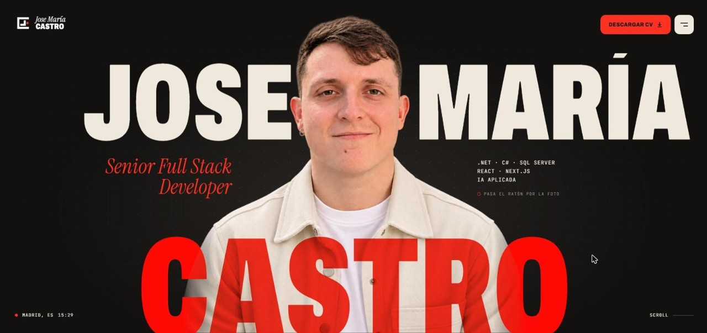

<p align="center">
  
</p>

# josemcastro.dev

Código de mi portfolio personal: [josemcastro.dev](https://josemcastro.dev).

<p align="center">
  <a href="https://josemcastro.dev"></a>
</p>

Soy José María Castro, desarrollador full stack (.NET, React, Node.js). En la web están mi experiencia, los proyectos en los que he trabajado y un formulario de contacto.

## Stack

- **React 19** y **Vite 6**, sin framework por encima.
- **GSAP** para las animaciones.
- **Prerenderizado propio**: tras el build, `scripts/prerender.mjs` renderiza la página a HTML y la inyecta en `dist/index.html`, para que buscadores y asistentes de IA lean el contenido sin ejecutar JavaScript.
- **Cloudflare Pages** para el alojamiento y **Pages Functions** para el formulario de contacto (`functions/api/contact.js`), que envía el correo con Resend.
- Español e inglés, con datos estructurados (JSON-LD) y `llms.txt`.

## Desarrollo

```bash
npm install
npm run dev
```

```bash
npm run build     # build de cliente + SSR + prerenderizado
npm run preview
```

## Variables de entorno

El formulario de contacto necesita dos variables en Cloudflare Pages. No hay ninguna clave en el repositorio.

| Variable | Para qué |
|---|---|
| `RESEND_API_KEY` | Clave de la API de Resend |
| `CONTACT_FROM` | Remitente de los correos del formulario |

## Estructura

| Ruta | Contenido |
|---|---|
| `src/` | Componentes y estilos |
| `public/` | Imágenes, fuentes y la landing de desarrollo web en Alcobendas |
| `functions/api/` | Función del formulario de contacto |
| `scripts/` | Prerenderizado |
| `DESIGN.md` | Sistema visual: colores, tipografía y criterios de diseño |
